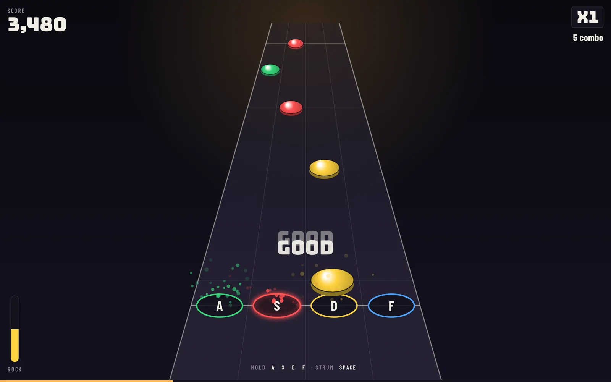
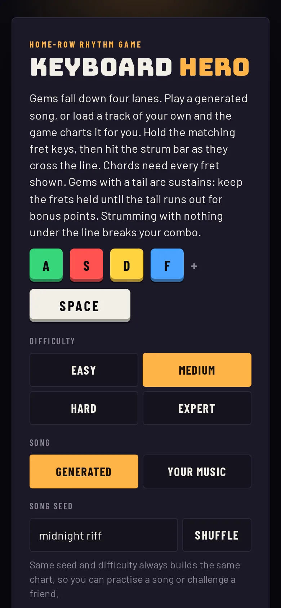

# Keyboard Hero

[](https://github.com/ali-raheem/keyboard-hero/actions/workflows/ci.yml) [](https://github.com/ali-raheem/keyboard-hero/actions/workflows/pages.yml)

**▶ Try it live: [shoryuken.me/kh](https://shoryuken.me/kh/)** · mirror on [GitHub Pages](https://ali-raheem.github.io/keyboard-hero/) · installable, works offline

<p align="center">
  <a href="https://shoryuken.me/kh/"></a>
  <a href="https://shoryuken.me/kh/"></a>
</p>

A Guitar Hero–style rhythm game for the keyboard. Plain ES modules with no build step and no dependencies, installable, and it works offline: generated songs are synthesised on the fly and your own tracks are analysed in the browser.

## Run it

Serve the folder over HTTP (ES modules and the service worker don't load from `file://`):

```bash
npm run serve   # python3 -m http.server 8080, then visit http://localhost:8080/
```

## Play

- **A S D F** — hold the fret(s) shown on the falling gems
- **Space** (or Enter / arrow up / arrow down) — strum when the gem reaches the line
- **Esc** — pause

### Playing your own music

Pick **Your music** on the menu and choose an MP3, OGG, WAV, M4A or FLAC file. The file is decoded and analysed in the
browser and never uploaded. The game listens for the track's tempo, beats and hits, then builds a chart:

- Onsets come from spectral flux in four frequency bands. Tempo is picked by autocorrelation with a prior around 120 bpm,
  and beats are placed with a dynamic-programming tracker so slight tempo drift is followed.
- Hits are snapped to sixteenths of the tracked beat. Difficulty decides which grid positions and how strong a hit must be
  to become a gem, with a minimum spacing per level.
- The lane comes from which band jumped most relative to its usual level, so kicks tend to sit left and cymbals right.
  Very strong hits on Medium and above can become chords, and gems whose sound rings through the following gap can become sustains.
- Hits play a quiet pick, and misses dip the track for a moment in place of the muted guitar stem the real game has.

Percussive music charts best. Quiet or heavily reverbed tracks produce sparse charts, and the menu warns when few hits were found.
Best scores are only kept for generated songs, since every loaded track is different.

### Timing offset

Set a **timing offset** in milliseconds on the menu to absorb your keyboard and audio latency. If your hits keep landing late,
raise it. The results screen reports your average timing error and suggests an offset when it is worth changing.

Chords need every shown fret held and nothing else. Single notes allow "anchoring": you may keep lower frets held, but no higher one.
Strumming with no gem in the window is an overstrum and breaks your combo, as in the real game.

**Sustains.** A gem with a tail is a sustained note. Hit it as normal, then keep its frets held while the tail passes the line.
Letting go early ends the sustain (and the guitar tone) without breaking your combo; you just stop earning tail points.
Extra frets pressed during a sustain do not hurt.

## Scoring

- 50 points per gem, times the combo multiplier (x2 at 10, x3 at 20, x4 at 30). Perfect timing (±50 ms) adds 10.
- Sustains pay 25 points per gem per beat held, times the multiplier, and top up the rock meter when held to the end.
- Timing window is ±120 ms.
- The rock meter rises on hits and falls on misses and overstrums. Empty it and the song fails.

## Songs

Generated charts and backing tracks come from the seed text plus the difficulty, so the same seed always gives the same song.
Audio is synthesized with the Web Audio API: distorted guitar tones on each hit, plus a drum and bass backing.

| Difficulty | Lanes | Density | Chords | Sustains | Scroll time |
|---|---|---|---|---|---|
| Easy | 3 | quarter notes | none | frequent | 2.0 s |
| Medium | 4 | quarters + some eighths | 2-note | common | 1.7 s |
| Hard | 4 | eighths + occasional 16th runs | 2–3 note | some | 1.5 s |
| Expert | 4 | dense eighths and 16th runs | 2–3 note | few | 1.3 s |

A sustain only appears where there is at least half a beat of rest before the next gem, so tails never overlap the next note.
The final chord of every song is a four-beat hold.

Best scores per difficulty are kept in `localStorage`.

## Structure

| File | Role |
|---|---|
| `js/song.js` | Seeded RNG, game constants and the procedural chart and backing generator. DOM-free. |
| `js/analysis.js` | Charting your own track: FFT, spectral-flux onsets, tempo, beat tracking and the chart builder. DOM-free. |
| `js/app.js` | Web Audio synth, game loop, judging, the canvas highway, menus and input. |
| `js/version.js` | `VERSION` and `BUILT`, shown under the menu. |
| `sw.js` | Offline cache for the app's own files. |
| `fonts/` | Bundled Bungee, Barlow and Barlow Condensed (Latin subset) with their licences. |

## Releasing

```bash
npm test
npm run bump    # patch; or: npm run bump -- minor | major
```

The service worker cache is keyed on `VERSION`, so bumping it moves installed copies onto a fresh cache.

## Tests

`npm test` runs the Node test runner over `tests/`: chart determinism and shape for every difficulty, the analysis pipeline on a synthetic click track, and checks that the service worker caches every shipped file and stays inside its own scope and caches.

## Licence

[MIT](LICENSE) © 2026 Ali Raheem. The bundled fonts in `fonts/` (Bungee, Barlow and Barlow Condensed) are under the SIL Open Font License 1.1; see their licences in that folder.
